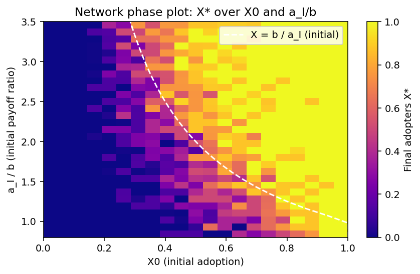

# EV Adoption as a Stag Hunt Game

Model-Based Decision Making (University of Amsterdam)
Rosa Muilu & Tess Keet

This project models electric vehicle (EV) adoption as a Stag Hunt coordination game on a social network. Drivers switch to an EV when its payoff beats that of an internal combustion engine (ICE) car, and that payoff grows with the number of other adopters and with the available charging infrastructure. We use the model to find leverage points that push the system out of a low-EV equilibrium, and to test a carbon-tax policy across network types.

Code, setup instructions and outputs are in [`model_code/`](model_code/README.md). The model builds on the base code by Lees (2025).

## Setup

- 150-node network, 70 time steps, 200 trials per scenario
- Default: Barabási–Albert (BA) network, initial adoption X₀ = 0.40, initial infrastructure I₀ = 0.05, infrastructure feedback β_I = 2.0
- Success metric: probability that final adoption reaches at least 75%

## Main findings

### 1. The system is bistable, and initial adoption is the key leverage point

Runs end in either a low-EV or a high-EV equilibrium, with little in between. Which one the system reaches depends mainly on how many people adopt at the start. Infrastructure and feedback strength barely move the outcome.

| Scenario | Success rate (≥ 75%) | Speed (steps) |
|---|---|---|
| Baseline | 49.5% | 1.4 |
| Initial adoption X₀ = 0.3 | 23.0% | 2.2 |
| Initial adoption X₀ = 0.5 | 65.0% | 0.6 |
| Initial infrastructure I₀ = 0.15 | 48.0% | 1.6 |
| Initial infrastructure I₀ = 0.25 | 46.5% | 0.7 |
| High β_I (3.0) | 49.5% | 1.1 |
| Low β_I (1.0) | 46.5% | 0.8 |

The phase plot shows that raising the EV payoff relative to ICE can reach the same high-adoption region without increasing the number of initial adopters. That makes payoff a practical policy lever.

### 2. Network structure shapes how adoption spreads

| Network | Avg clustering | Avg degree | Largest component |
|---|---|---|---|
| BA (scale-free) | 0.0957 | 3.95 | 150.0 |
| ER (random) | 0.0496 | 7.46 | 149.9 |
| Grid | 0.0000 | 3.67 | 144.0 |

- **BA:** hubs can trigger rapid cascades when they adopt early, but they become bottlenecks when they don't, so outcomes are sensitive to initial conditions.
- **ER:** fast adoption and a high chance of the high-EV equilibrium, without hub-driven cascades.
- **Grid:** most prone to local blockades in principle; in these runs the initial adopters happened to be well spread and the grid reached full adoption.

### 3. An early, moderate carbon tax is the most balanced policy

The policy lowers the ICE payoff `b` to mimic an economy-wide carbon tax. Options were tested one step at a time (timing → strength → network).

| Scenario | Success rate (≥ 75%) | Speed (steps) |
|---|---|---|
| Baseline (no intervention) | 49.5% | 1.4 |
| Early intervention (t = 0) | 76.0% | 0.8 |
| Late intervention | 54.5% | 4.5 |
| Weak tax (Δb = −0.2) | 66.0% | 0.7 |
| Medium tax (Δb = −0.3) | 76.0% | 0.7 |
| Strong tax (Δb = −0.4) | 86.5% | 0.6 |
| BA, medium tax | 76.0% | 0.8 |
| ER, medium tax | 100.0% | 0.3 |
| Grid, medium tax | 100.0% | 0.6 |

- **Timing matters most.** Once the system settles into an ICE-dominated state it resists the payoff change, so a late tax adds little.
- **Strength shows no sharp threshold.** Success rises steadily with tax strength. The medium tax gives most of the gain while staying politically more realistic.
- **Homogeneous networks respond best.** ER and Grid reach 100% success; BA stalls at 76% because its hubs can block diffusion. A version targeting hubs could close that gap.

## Limitations

- One-factor-at-a-time sweeps miss interactions between parameters; Morris or global sensitivity analysis would be a better next step.
- Computational limits meant exact tipping thresholds weren't pinned down, and only 150-node networks were tested. Larger scale-free networks may cascade differently.
- Results are averages over stochastic runs; individual trajectories can diverge noticeably.

## AI statement 
This README was drafted with the help of an AI assistant (Claude) and reviewed and edited by the authors. The model, analysis and findings are our own.

## Reference
Lees, M. (2025). *Model-Based Decisions Assignment 3 Code* [Source code]. GitHub. https://github.com/mhlees/Model-Based-Decisions-Code/tree/main/Assignment%203
